# 成人血压指南问答中的自适应检索与证据核证

## 摘要

临床指南问答需要同时判断是否检索、是否追加检索，以及所获条款能否支持回答。本文以成人血压测量、筛查和诊断为场景，将四份指南或建议与两份系统综述整理为80条证据，使用36道开发题、26道测试题和24道新意图挑战题比较检索与核证策略。针对范围误拒和互补证据遗漏，系统结合机构与测量概念识别问题，按子问题分配候选，并在补检时保留已有支持条款。改进后的自适应系统在22道可答测试题中回答15道，14道引齐指定条款，4道通过预设短语与引用的联合评分。逐项文献核读由AI代理辅助完成，判定14道回答满足题面要求，另有一道虽引述真实统计，却混淆初筛与确诊阶段。挑战集自适应策略在20道可答题中完整引用13题，严格短语评分为0/20；直接提供全部参考条款后，该评分仍为0/20。两类评价之间的差异要求分别分析表述匹配、证据支持和题面要求。实际追加检索在两道挑战题中找回缺失条款，尚未提高严格通过数。实验表明，问题分解与来源保留影响材料覆盖，按问题阶段解释证据及识别可答请求则决定了核证带来的收益与误拒代价。

**代码仓库：[https://github.com/stq1234/LLMandAppliedPractices-Clinical-Guideline-RAG](https://github.com/stq1234/LLMandAppliedPractices-Clinical-Guideline-RAG)。本次实验的代码及相关说明可在该仓库中获取。**

**关键词**　临床指南；检索增强生成；自适应检索；证据溯源；拒答；多阶段推理

## 1　临床指南问答中的证据需求

医生查阅成人血压指南时，“测量时两次读数应间隔多久”和“这组家庭读数能否用于确认高血压”需要不同的依据。前者通常可以由一项操作要求回答；后者还涉及测量时段、读数如何汇总及其适用的诊断标准。同一数值出现在不同机构的指南中，也可能对应不同的测量场所。如果医生随问题提供了先前查阅的条款，系统还须判断那条材料是否已经回答了当前问题。[1,2]

检索增强生成（retrieval-augmented generation，RAG）将查找资料与撰写回答分开。检索器先从指南库找到可能相关的条款；生成模型阅读这些条款，据此组织答案并引用来源。每次送入生成模型作为阅读材料的文字称为上下文。一轮检索是围绕当前问题或其子问题向知识库查找一次材料。系统可以不发起新检索而沿用已有材料，也可以在发现缺口后继续查找。选错路径有不同的后果：无依据地作答会把未经证实的结论交给读者，可答时拒答会让医生重复查阅，无效补检则增加等待时间。

### 1.1　三种机制在系统中的分工

自适应检索（Adaptive-RAG）根据当前问题选择计算路径。Jeong 等让模型在直接作答、单步检索和多步检索之间选择，使简单问题承担较少的推理开销。[6] 本研究以这项选择作为系统主干，文中将选择路径的过程称为路由。医院场景对来源有明确要求，因此，直接作答只在已有材料足以支持答案时可行。即使问题很短，涉及特定人群或测量条件也可能需要查找条款；较长的问题若已附上完整依据，反而可能直接回答。

多阶段检索推理（RAG-Reasoning）将一个问题拆成若干可由文献回答的子问题，再由上一轮获得的证据决定下一轮要查找什么。[7] 例如，动态血压监测（ABPM）使用可随身携带的设备在一段时间内自动测量，家庭血压监测（HBPM）则由受测者在家按规定测量。若问一份指南如何用两种方法确认诊断，检出家庭测量的条款只解决了一部分问题。系统还需查找动态监测的规定，保留各自的观察时段和统计方式。[1]

自反思检索增强生成（Self-RAG）将判断材料是否相关、现有材料是否支持陈述等能力引入检索和生成过程。[8] 本文借鉴这一思路，在生成过程中逐项核证，即检查每项事实陈述能否由它所引用的具体条款推出。例如，引文提到正确的血压阈值，但适用的是夜间监测，便不能直接支持有关全天均值的陈述。系统据此决定补查、作答或拒答。该核证由现成语言模型在回答时完成，原论文采用的反思信号训练属于另一种实现。

### 1.2　研究问题

本研究首先观察三个环节。其一，问题与已有材料在什么条件下足以支持零轮、单轮或多轮检索；其二，首轮材料不完整时，再查一次是否取得先前缺失的条款，以及回答最终是否引用了这些条款；其三，开发问题上不同决策的实际结果能否指导后续请求何时优先使用已有材料。扩展实验进一步检验，在知识库保持固定时，改进范围判断、需求拆分和证据分配后的系统能否处理独立构造的查询意图。实验分别统计材料覆盖、带依据的作答、拒答和模型调用开销。

## 2　知识来源与问题构造

### 2.1　按推荐条款和研究结论组织证据

本研究将应用限定于医务人员查阅成人血压测量、筛查及诊断确认的场景。采用这一范围，可以在同一领域内同时比较短事实查询、跨条款推理和机构间的差异。以“130/80”为例，指南中出现的数值可能表示分类界限、特定测量环境下的参照水平，亦可能只是某项研究比较的阈值。能否在答案中保留机构、测量场所、统计时段和用途，是比数字匹配更严格的证据要求。个体处方、妊娠专科诊疗及儿科治疗属于另行界定的服务范围。[1–5]

知识库包含 80 条中文证据释义。指南给出对特定人群的实践建议，系统综述则按明确的问题和纳入标准汇总多项研究；两者对回答所能提供的支持不同。每条记录对应一个可定位的指南建议、表格项目或系统综述结论，保存来源、机构、版本、适用人群、章节位置、正文及主题词。释义保留原材料的条件和单位，便于中文检索。系统向读者提供的出处包含条款位置和原始来源链接，生成时摘引的文本则来自库内的中文释义。两种出处承担不同功能，前者用于回到原始出版物核查，后者用于检查生成陈述究竟取自哪条记录。

**表 1　纳入的临床证据及其在问答中的作用**

| 来源 | 记录数 | 主要证据与解释单位 |
|---|---:|---|
| 英国国家卫生与临床优化研究所（NICE）成人高血压指南 NG136 | 27 | 推荐编号所对应的测量、诊室外确认、体位变化及特定条件下的进一步评估 [1] |
| 美国心脏协会与美国心脏病学会（AHA/ACC）2025 成人高血压指南 | 16 | 美国指南的诊室读数分类、测量方法及诊室外对应值 [2] |
| 国际高血压学会（ISH）2026 全球高血压实践指南 | 20 | 分类术语、标准化诊室测量、家庭与动态监测、确诊条件 [3] |
| 美国预防服务工作组（USPSTF）成人高血压筛查建议 | 7 | 推荐筛查的人群、筛查间隔及诊室外确认在筛查流程中的位置 [4] |
| Guirguis-Blake 等的系统综述 | 7 | 以动态监测为参照的筛查或确认准确性，以及筛查相关伤害 [5] |
| Deragon 等的系统综述与荟萃分析 | 3 | 同一设备、同一测量方案下，有人和无人自动诊室测量的配对差值 [11] |

两份综述处理的统计问题不同。Guirguis-Blake 等以参照方法的结果为准，考察筛查或确认测量能识别多少实际阳性者（敏感度），以及能正确排除多少实际阴性者（特异度）；同一个“诊室测量”在初筛和确认阶段具有不同用途。Deragon 等则对多项研究的数值结果作荟萃分析，考察医务人员是否在场与同一人在两种条件下的读数差异。检索到同主题的测量研究，尚须判断研究回答的是诊断准确性还是读数差异。[5,11]

### 2.2　可答性、问题复杂度与上下文

题库包含 62 个中文问题，36 个用于设定与比较决策规则（开发集），26 个用于在固定规则下比较运行表现（测试集）。每个问题对应一个需要回答的具体意图，测量、筛查等较宽的题型可以跨两组出现。编制题目时，逐题标出回答必需的条款和要点。这组由题库指定、用于评判系统输出的条款以下称为参考证据，表中简称“金标”。问题还可以附有医生先前已调出的材料，称为预置证据。系统在回答时只得到问题和预置证据；参考证据与预期要点保留给评分程序。两组共用知识库，因此这里比较的是新提问及证据组合上的表现。

**表 2　开发集与测试集的问题和初始证据分布**

| 条件 | 开发集 | 测试集 |
|---|---:|---:|
| 问题总数 | 36 | 26 |
| 一条记录足以回答 | 28 | 11 |
| 需联合两条及以上记录 | 6 | 11 |
| 领域内但库中缺少所问依据 | 1 | 2 |
| 超出一般成人测量与诊断范围 | 1 | 2 |
| 未预置证据 | 19 | 9 |
| 预置材料与指定证据无交集 | 14 | 9 |
| 预置部分指定证据 | 0 | 5 |
| 预置全部非空指定证据 | 3 | 3 |

表 2 下半部分按标识集合间的包含关系计数，包括标有范围说明的请求。对范围外问题，即使有一条说明适用范围的记录，也不构成给出所问个体方案的依据。测试集 22 个可答请求中，单证据题和多证据题各占一半。后者包括同一机构内联合测量与确认条款，以及横向比较两份指南。金标所度量的是各项必要证据能否齐备：两份指南只找到其中一份时，已检出有用材料，但尚不足以回答整个比较问题。

可答性与检索必要性分开标注。例如，若提问索要一份指南中是否存在某项具体换算规则，查询本身属于该指南范围，检索后仍可能只能说明现有知识库缺少依据。若问题已明确要求为具体患者选择降压药和剂量，则可在检索前结束。由此得到两类不同的正确拒答，前者检验系统对资料覆盖的辨别，后者检验服务边界。范围内请求能否复用现有上下文，还取决于所给记录能否共同支持指定答案。

为检验新问题意图上的决策迁移，另构造一组独立挑战题。挑战集保留相同的80条证据和来源版本，仅新增问题，不并入原有36道开发题与26道测试题。题目按六个意图族预先组织，每族4题：测量流程、阈值与数值对应、条件路径、跨来源决策、综述证据解读及证据边界。共20道可由库内材料回答，2道询问语料未收录的数值或准确性指标，2道涉及儿科阈值或个体化用药；可答题中11道需要联合多条证据，9道由单条证据支持。3道可答题将完整金标作为可信上下文，13道只给部分或相关材料，8道不给上下文。每题的参考条款、答案关键点和意图标签只供评测端使用，推理端只接收问题和预置证据标识。挑战题共享原知识库，因此它度量的是固定来源与证据上的新意图泛化，不是对新机构或新指南来源的外部泛化。

## 3　自适应检索与主张核证

### 3.1　证据表示与候选排序

Qwen3-Embedding-8B 将查询和证据分别编码为4,096维向量。查询端在问题前加入成人血压测量、筛查与诊断的任务指令；文档端串接标题、主题词、适用人群和证据正文。模型把文本分为词元，经词元嵌入和解码器式 Transformer 层形成隐状态。每层自注意力按查询与键的相似度分配权重并汇集值向量，多头机制并行建模多组关联，因果掩码使位置 $t$ 只读取自身及此前词元。旋转位置嵌入（Rotary Position Embedding，RoPE）作用于注意力的查询与键，使位置信息进入相似度计算；前馈子层逐位置变换结果，残差路径保留此前表征。[13] 单头注意力可写为

$$
\mathrm{Attn}(Q,K,V)=\mathrm{softmax}\!\left(\frac{QK^{\top}}{\sqrt{d_k}}+M\right)V,
$$

其中 $Q,K,V$ 是隐状态的线性投影，$d_k$ 是键向量维度，$M$ 屏蔽未来位置。模型取最后一个非填充词元的隐状态作为整段表示，不对全部词元作平均池化；因果注意力使末位隐状态可汇集整个输入。所得4,096维向量经 $L_2$ 归一化后，内积等于余弦相似度。查询文本使用检索指令，文档文本由标题、主题、人群和正文构成；文档向量可预先计算。[9]

Qwen3-Embedding 上游采用多阶段训练，包括大规模弱监督对比预训练、高质量标注数据监督微调和候选模型合并。对比阶段为查询构造相关条款正例 $d^+$ 和不相关或难区分的负例集合 $D^-$。若 $s(q,d)$ 为相似度、$\tau$ 为温度，则标准对比目标写为

$$
\mathcal{L}(q)=-\log\frac{\exp(s(q,d^+)/\tau)}{\exp(s(q,d^+)/\tau)+\sum_{d^-\in D^-}\exp(s(q,d^-)/\tau)}.
$$

该目标提高正例相对负例的分数，温度控制 softmax 分布的尖锐程度。[9] 本研究固定使用发布的 Qwen3-Embedding-8B 和 Qwen3.6-35B-A3B 权重；学习发生于上游多阶段训练，实验调节的是路由阈值和检索系数。[9,10]

合格证据先受人群适用性筛选。记录按适用与排除人群分别编码；缺少结构化字段时，从主要适用条款推断范围。因此成人指南注明“妊娠另见专门指南”不会把整份指南重分类为妊娠证据。系统进一步区分显式血压主题与基于可信证据的短追问上下文。

稠密相似度与BM25共同排序。BM25（Best Matching 25）以逆文档频率降低常见词的权重，并考虑词频饱和及文档长度校正。[12] 对含 $N$ 条合格证据的候选集合，令 $T(q)$ 为查询去重词项集合，$f(t,d)$ 为词项频数，$|d|$ 为文档词数，$\overline{|d|}$ 为平均长度，$df(t)$ 为含词项的文档数，则词面分数为

$$
\mathrm{BM25}(q,d)=\sum_{t\in T(q)}\log\!\left(1+\frac{N-df(t)+0.5}{df(t)+0.5}\right)\frac{f(t,d)(k_1+1)}{f(t,d)+k_1\left(1-b_{\mathrm{len}}+b_{\mathrm{len}}\frac{|d|}{\overline{|d|}}\right)}.
$$

实现取 $k_1=1.2$、$b_{\mathrm{len}}=0.75$，并按当前候选中的最大值把 BM25 缩放至 $[0,1]$。英文和数字作为独立词项，较长中文串拆为相邻二字片段并保留原串。令 $b(q,d)$ 为缩放后的词面分数，指南记录的先验项为0.025、综述记录为0，则最终分数为

$$
s(q,d)=\mathbf e_q^{\top}\mathbf e_d+0.15\,b(q,d)+0.025\,\mathbb{1}[d\ \text{为指南条款}] .
$$

首轮检索对原问题取前5条。若多个方面共同决定答案，首轮分数以与各方面的最高稠密相似度计算，词面分汇总各方面词项；一次补检对未支持方面再次取前5条。两轮记录以稳定标识去重、以最高分排序并保留至多8条，形成集合并 $E_i$。题目参考证据为联合金标 $G_i$，完整召回要求 $G_i\subseteq E_i$；只检回部分条款不能完成多机构比较或条件组合。语料评价分别统计至少命中一条、逐题平均金标召回比例和全部金标召回率。

### 3.2　检索前的路由与检索后的停止条件

领域门控先检查成人血压测量与诊断范围、个体治疗请求及儿童/妊娠边界，再计算查询路由特征。令 $T(q)$ 为问题的去重词项集合，$T(d)$ 为预置条款的词项集合，$S_0$ 为调用方给出的可信记录；最强预置覆盖为

$$
c(q,S_0)=\max_{d\in S_0}\frac{|T(q)\cap T(d)|}{|T(q)|},
$$

当 $S_0$ 为空时令 $c=0$；所有预置条款还须符合问题的人群范围。问题方面数 $h$ 由启发式切分器根据句末标点、并列词及测量/诊断意图估计，复杂度分数为 $a(q)=\min(1,(h-1)/2)$。门控接受问题后，若 $S_0$ 非空、全部适用且 $c\geq0.35$，初始动作选复用；否则，$a(q)\geq0.50$ 时选多轮，其他情况选单轮。最多三项的证据规划器保留问题中的人口、来源和测量限定，供证据核证和补检使用。

设证据需求数为 $m$，经核证得到有效引文支持的需求数为 $v$，缺口比例为

$$
g=1-\frac{v}{m}.
$$

初始多轮动作固定追加一次检索；自适应单轮与复用路径在核证后若 $g\geq0.25$，则按未支持方面补检一次。追加后重新检查全部需求；任何一项未获支持、没有可用证据或引文锚点无法定位时，系统拒答，不继续检索循环。最大方面数为3，因此一个未支持方面已达到0.25阈值。降低复用阈值改变的是证据是否先复核；改变此停止阈值则直接影响补检与拒答。

### 3.3　逐项引证、语义核证与拒答

规划、核证、写作和主张复核由同一 Qwen3.6-35B-A3B 在推理阶段完成。生成器按条件概率逐词元展开；给定问题 $q$、需求列表 $F$ 和最后一轮证据 $E$，长度为 $T$ 的输出 $y$ 满足

$$
p_{\phi}(y\mid q,F,E)=\prod_{t=1}^{T}p_{\phi}(y_t\mid y_{<t},q,F,E),
$$

其中 $\phi$ 为生成模型参数，$y_{<t}$ 为已生成前缀。推理温度为0、top-p为1，首轮输出上限768词元；若发生长度截断，则把同一调用的上限扩至2,048词元重试。[10]

证据核证器将模型问题拆分为1–3个需求，对每项返回支持状态、来源标识、连续摘引和补检查询。确定性锚点检查要求引用标识属于当前上下文，摘引经空格/大小写规范化后为源记录连续子串且有效字符不少于6，并检查证据人群适用性。写作器把每个事实句拆为独立主张并绑定至少一条证据。语义核证器只检查该摘引是否推出主张、来源是否属于相应人群及证据类型，并要求复核返回的支持标识与该主张引用的标识相交；任一必要需求或主张未通过时整题拒答。标识合法、锚点可定位和主张语义受支持分别记录。

关闭语义核证的对照组以词面覆盖代替模型支持判断：若一个需求与任一可见记录的去重词项重合比例达到0.20，机械检查便视其受到支持。该模式仍需通过引用标识与连续摘引检查，只省略生成式需求核证和最终语义主张复核。

### 3.4　改进路径中的领域判断与分面召回

为检验新的提问意图，扩展系统在既有证据表示上改进范围识别、需求拆分和候选组织。领域词汇由语料机构名称、机构简称和具体主题词汇总而成。明确的血压测量或诊断词汇可直接触发领域识别；仅提到 NICE、USPSTF 等覆盖多个领域的机构时，还须在问题中匹配一个具体血压主题。ISH 等血压专业机构使用其专属别名；在已验证的血压条款之后，带有“这条/上述方法”等指代的短追问可继承上下文范围。个体用药、妊娠及未成年人规则仍先于一般机构匹配。

扩展规划器只将原问题中可逐字定位的连续片段作为方面，并保留显式句界和并列要求。问题中的机构名称、人口限定、测量场所和数字同时作为锚点附加到分面查询，防止缩短后的子查询丢掉来源或适用范围。单一需求时保留原问题作为一项；多项要求按最多三方面组织。扩展规划不把模型自行提出的“风险评估”“管理建议”加入医生未提出的问题。

候选检索按方面分别计算同一套稠密—BM25分数。查询明确命名一个机构且可用记录中存在该机构资料时，该方面先在该机构的记录中排序；问题同时命名多个机构时，各来源在候选列表中交错排列，再按方面轮流取候选，避免一个高分通用段落耗尽前五条预算。预置证据始终进入模型上下文，首轮核证已确认支持的来源也在补检合并时受到保护。若调用方提供的兼容证据或已确认来源超过名义八条预算，合并器相应扩展上下文，以保留这组必需材料。

扩展系统默认要求各证据方面均获支持后才作答；可选的部分回答模式只输出已核证方面并列出未答需求。新版评测采用全有或全无策略，检索分配和上下文保留按上述分面、来源和人群规则实施。

## 4　比较条件与评价方法

### 4.1　同题对照与两次检索决策

五种策略在相同测试问题、相同预置资料、相同知识库和模型下逐题比较。仅用给定材料组复核预置来源并执行零轮检索。固定单轮与固定双轮组均从原始查询开始；第二轮以核证所识别的缺项或问题分面作为查询。规则自适应组允许在复用、首检和补查之间转换。取消语义核证的自适应组以词面覆盖估计缺口，同时保留标识与摘引的机械校验。适用范围判定先于上述策略，范围外问题可在任何组中直接拒答。经开发日志选择阈值的自适应策略另外报告。

初始决策依据题库预置资料和可答性定义参照动作。当题内所需证据已完整提供，或问题明确超出领域时，无需启动检索；其余问题需要查库，包括库内检索后才可判断的证据缺失。统计时分别计数应查而未查、无需查而仍查，以及可答题在范围判定处被误拒的情形。第二次决策则以首轮实际取得的记录为基准，区分首轮仍缺金标、执行了追加查询、补回至少一条缺失金标、最终找齐及最终正确引证。仅仅产生了新候选，不能计作补齐了缺失依据。

### 4.2　回答、拒答与运行开销

对可答问题 $i$，令 $G_i$ 为题库给出的全部参考条款，$E_i$ 为模型最终读到的条款，$C_i$ 为答案实际引用的条款。$G_i\subseteq E_i$ 表示材料已经找齐，$G_i\subseteq C_i$ 则表示回答已完整引用这些依据。例如，一道比较两家机构规定的题目若需两条证据，模型读到两条、只引用一条，应计入前一种成功，不能计入后一种。答案内容另按预先列出的要点评分，每个要点可以有若干等价表述。评分前移除引文标识，统一数字、比较符号和常见写法，保留阈值的方向。只有实际给出答案、全部要点均命中且参考条款引证齐全时，一题才计入“要点与引证联合通过”。语义正确的改写也可能超出预设表述，因此文中另将实际答案与条款对读。

可答题的误拒与不可答题的正确拒答分别计数。四个应拒请求中，两个超出服务范围，另外两个在领域内但库中缺少具体依据。给出肯定回答而无完整金标的题数用于识别可能的引证缺口，还须检查是否存在等价依据才能解释为实质性错误。资源开销按题累计全部模型调用、输入输出词元、实际检索轮数及端到端时延。共享推理服务上的时延含排队和并发影响，研究主要据词元与调用量解释策略间重复阅读的代价。

### 4.3　历史决策日志与阈值选择

线上初始路由阈值控制的是先复核给定材料的机会。直接把旧日志中的“最终答对”当作“第一次决策正确”，会将补检挽救的回答错误地归功于初始动作。本文利用 36 个开发问题的默认自适应轨迹，并对降低阈值可能改变首个动作的问题另行强制尝试复用。后者仍执行证据核证，发现缺口时仍可转入检索。这样，同一个开发问题得到的是两种初始动作及其后续真实结果，而不是将“只准使用当前材料”的静态对照当作完整自适应系统的反事实。

阈值选择针对给定证据能否更经济地承载回答，仅调整 $\tau_0$，多阶段初始阈值和追加检索阈值保持固定。实验在 0.05 至 0.35 之间比较候选门槛。设 $W$ 表示系统实际交付了未通过关键点判定的答案，或对本应拒答的问题给出回答；$U$ 表示可答题已给出答案但缺少至少一条指定引用；$F$ 表示可答题被拒。令 $N$ 为累计输入和输出的词元数，$R$ 为检索轮数，则开发集的单题比较损失为

$$
L=100W+100U+30F+0.002N+0.5R .
$$

同一条回答可以同时产生关键点损失与引证损失，误拒只计入 $F$。模型排队时延的波动较大，计算开销在损失中只按词元数和检索轮数计入。这些权重是用来比较检索策略的实验设定。对每个候选阈值先按题型求平均，再对题型等权汇总。将各题型的平均损失视为一组观测，以其样本标准差除以题型数的平方根估算标准误，用以描述不同题型给总体估计带来的波动。在最小损失加一个标准误的范围内，选择最接近默认值的门槛，以减轻少量问题对参数的影响。候选门槛、比较损失与可见特征均由开发集确定。测试组用于观察固定策略在另一批请求上的表现。

### 4.4　独立挑战集与迁移判定

挑战集为新增的24条问题记录，按测量流程、阈值对应、条件路径、跨来源决策、系统综述解释及证据边界六个意图族各编4题，独立于原开发集和测试集。问题与证据版本固定后才交由推理服务处理；与主评测一致，运行接口只读取问题和可选预置证据，金标标识、来源分组、期望要点、可答性和复杂度均不进入提示。扩展系统在新版题组上对比单轮、双轮、自适应和关闭语义核证的自适应路径，默认采用全有或全无回答策略。对每题记录是否拒答、最终上下文和引用所含金标、期望要点匹配、检索轮数与模型用量。联合通过要求可答题给出回答、所有关键点匹配并引用全部共同必需证据；语料内不可答和范围外题另按正确拒答统计。

挑战集与原测试题共享冻结的证据记录和来源，比较的是同一领域内新增提问意图及其证据组合上的处理表现。各族只有4题，因此族内比例用于描述错误分布，不用于细粒度显著性检验；挑战结果不视为新的来源外验证。扩展系统在36道开发题上检查后，采用初始复用覆盖阈值0.35、补检缺口阈值0.25、多方面路由阈值0.50，首轮和补检各保留前5条，默认上下文限8条，词面权重0.15，并要求所有需求均获支持后作答。随后对原测试集与挑战集按相同模型、证据库、参数及推理设置分别运行，完成26题×4模式和24题×4模式的200条逐题输出，均产生有效回答或拒答。主测试结果与挑战结果分开统计，新增题不改变原测试集的分母或既有指标。

运行指标区分逻辑模型调用和实际请求模型服务的次数。若相同版本和输入提示重复出现，生成响应可由服务响应缓存直接复用；每题的逻辑调用数与累计词元按完整推理过程统计，物理服务请求另行报告。缓存命中和共享服务排队都会影响端到端时延，因此时延不被解释为冷启动单请求的固定成本。

### 4.5　完整金标条件下的生成与核证诊断

对22道原测试可答题和20道挑战可答题，另将各题全部参考证据直接提供给同一模型，不执行检索。标准复用臂运行范围判断、复用路径、证据需求核证、写作、标识与摘引检查及语义主张校验。写作器对照臂使用相同问题规划与写作提示直接生成主张，绕过范围/路由、检索、批判核证、确定性引文验收和最终语义核验；其引文统计读取原始主张中的证据标识，衡量输出是否提及全部金标ID。模型只接收问题和金标证据正文/出处，不接收预期短语或答案标签。四个批次分别覆盖22、22、20和20个问题，均为有效输出。

该诊断比较完整证据下的端到端复用核证路径与写作器直接输出。写作器对照同时取消多项检查环节，因而不构成只移除单一核证器的实验；其原始标识数也不等价于经过锚点、人群和语义验证的可用引用。两臂仅作为oracle诊断单列，不并入四模式可部署路径结果。

### 4.6　固定证据库上的初检与子查询可行性

在不调用生成模型的条件下，对22道原测试可答题和20道挑战可答题在冻结的80条证据上比较词项、稠密、混合和查询显式机构过滤四种排序，候选深度取 $K=3,5,8$。完整覆盖要求全部共同必需证据均进入前 $K$ 条；来源过滤仅根据原问题明确点名的机构和证据元数据执行，不使用题库金标。逐题过滤对照只计实际启用过滤的显式来源问题，并将混合排序与同题过滤排序按金标召回变化配对；过滤前后的候选池规模同时记录。

子查询可行性分析以逐轮记录中实际生成的补检查询为输入，逐项独立重排后合并各子查询前 $K$ 条候选，并应用显式机构过滤。分母只包括实际生成补检查询的可答题。该分析估计给定补检需求的候选覆盖潜力；实际新增金标与答案是否被救回另按端到端系统输出计量。

## 5　原始基线配置的回答、拒答与检索开销

本节五种模式采用基线范围门控、原始分面规划和混合检索实现；以下主测试指标均来自这组原始配置。后续范围门控敏感性、扩展检索扫表和组合系统结果分别标注为诊断或扩展评测，不与本节分母合并。

### 5.1　可用证据与最终回答

相同的 26 道测试题分别交由五种策略处理。表 3 前四个结果列均以 22 道可答题为分母，每一格表示题数。最后一列以全部 26 道题为分母计算平均检索轮数。另有两道资料不足和两道范围外问题，五种策略均予以拒答。

**表 3　五种检索策略的证据覆盖与回答表现**

| 策略 | 模型读到全部必要条款 | 实际作答 | 引用全部必要条款 | 要点与引证联合通过 | 每题平均检索轮数 |
|---|---:|---:|---:|---:|---:|
| 仅用给定证据 | 1 | 1 | 1 | 0 | 0.00 |
| 固定单轮检索 | 9 | 7 | 7 | 1 | 0.46 |
| 固定双轮检索 | 9 | 7 | 7 | 1 | 0.92 |
| 规则自适应 | 9 | 7 | 7 | 1 | 0.77 |
| 自适应，关闭语义核证 | 8 | 10 | 8 | 1 | 0.65 |

固定单轮、固定双轮和自适应三组均在 9 道可答题上将必要条款完整纳入上下文，均在 7 道题上给出有完整指定引文的答案。另有两道题的上下文已经具备全部指定证据，核证器仍认为存在缺项并拒答。三组的严格联合通过数都只有 1/22。这个低值包含两种性质不同的失分：一些请求在检索前即被拦截；另一些给出了有依据的回答，但措辞或要点覆盖与题库判据不一致。第 6 节将答案与条款逐项比较。

图 1 将可答题和应拒问题分开。横线为二项比例的 95% Wilson 置信区间，用于说明在当前题数下比例估计有多不确定。1/22 对应约 0.8% 至 21.8%；两个应拒类别各只有两题，即使两题都正确拒答，各自区间下限仍约为 34.2%。四次正确拒答说明系统在这些具体问题上遵守了边界，样本量不足以精确估计其他临床提问的错误风险。

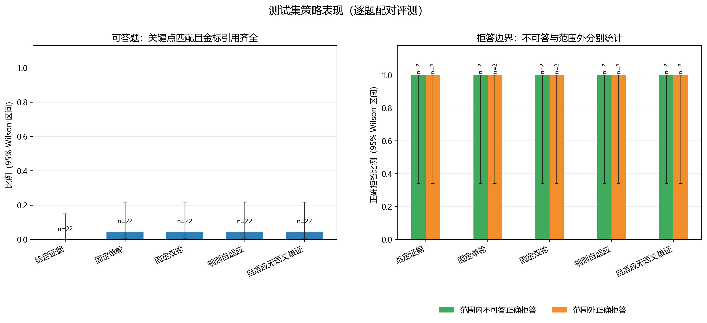

*图 1　左图要求同时命中全部规定要点和引用。右图分别统计“问题属于领域但缺少所问事实”和“问题超出服务范围”的正确拒答，黑线为每组比例的 95% 置信区间。*

### 5.2　核证减少了哪些回答，又增加了多少计算

关闭语义核证后，自适应系统对 22 道可答题的作答数从 7 增至 10，但新增回答中有两道未引用全部指定依据。最清楚的一例涉及系统综述。提问所指的是初筛后利用诊室测量**确认**的准确性，模型却摘取了**初筛**的统计结果。两组数字都出现在同一综述，条目也都能按标识定位，但研究所处阶段不同。另一例询问诊室复测后采用哪种监测确认，回答引用了测量次数及诊断阈值，却省略了直接规定确认路径的条款。前一个错误要求分清研究对象，后一个错误要求分清描述阈值与规定程序的文献功能。[1,5]

图 2 显示，取消语义核证减少了模型读取和生成的文字，也降低了返回答案前的平均等待。按每题所有生成与核证调用合计，五种策略平均输入和输出的词元数分别约为 337、1,864、2,772、2,476 和 856。平均开销涵盖检索前直接拒答的请求。单看实际调用语言模型的 12 道题，固定单轮、固定双轮和自适应三组的平均请求时间分别为 32.8、52.0 和 40.2 秒；自适应无语义核证组为 13.2 秒。共享服务在此期间还处理其他请求，这些时间描述此次实验中读者实际经历的等待。模型读取的词元数则直接反映不同策略重复阅读材料的程度。

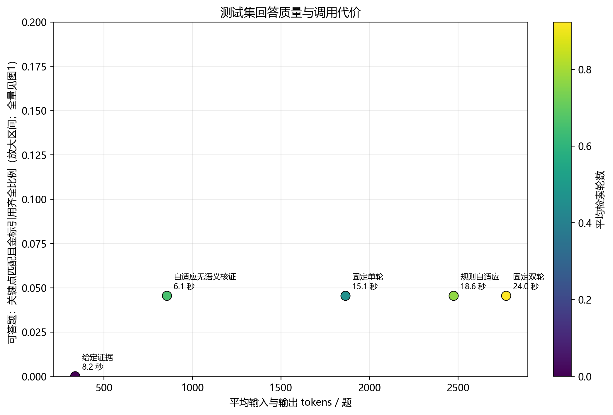

*图 2　横轴为每题累计输入与输出词元数，纵轴为可答题的联合通过比例，点的颜色代表每题平均检索轮数。文字标注的秒数为全部 26 道请求的端到端平均时延。*

### 5.3　第二轮究竟补回了什么

在自适应组的 22 道可答题中，首轮所见材料有 13 题缺少至少一条必要证据，其中包括在范围判断处直接退出、因而没有看到任何材料的问题。该组共对 7 道可答题执行了第二轮。将每题第二轮后保留的条款与此前的材料相减，7 题均未新增题库指定的必要条款。七次补检中只有一题属于“首轮确实漏掉必要条款”的情形，其余六题首轮已具备指定材料。另有两道领域内不可答题也执行了第二轮；这两题没有可补齐的参考答案，未计入图 3 的七道。

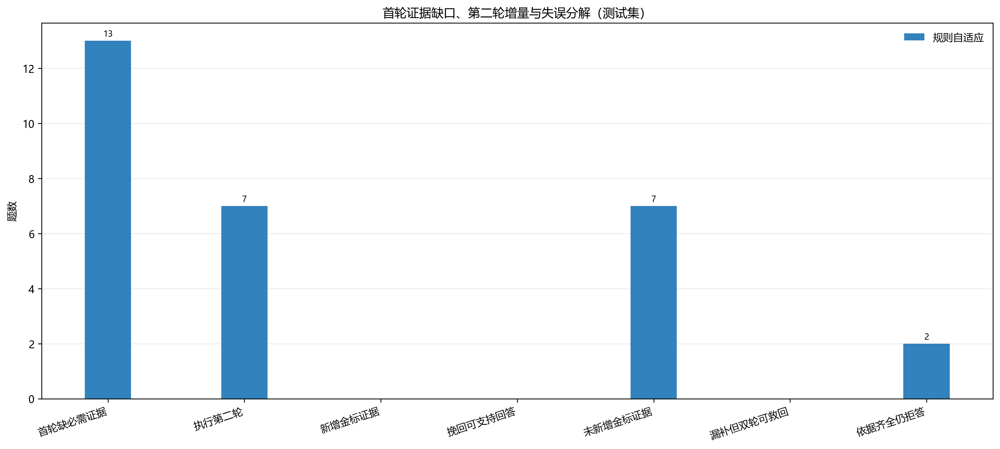

*图 3　各柱对应不同判断，不能相加为总题数。“新增”只计入首轮未见、补检后出现的必要条款；“依据齐全仍拒答”指最终上下文已有全部必要条款、系统仍未返回答案。*

这一结果解释了为何增加推理轮数没有改善本组的严格通过数。当核证器指出的是“原条款还不能支持我所提出的某个扩展问题”，缺口可能来自它对问题的拆分，而非缺少题目真正需要的材料。此时反复用同一扩大后的需求检索，可能只会增加近义条款。反过来，前置范围判断直接结束的请求连第一轮检索都没有发生。固定双轮组与自适应组共用这一范围判断，因而即使规定可接受问题必须检索两轮，也无法挽回已被拦截的请求。比较时，第二轮带来的**新增依据**比第二轮是否发生更贴近多阶段推理的目的。

### 5.4　何时应该启动首轮检索

测试题中有 22 道在初始条件下需要查库，另外 4 道可以不查。其中两道已有充分的预置材料，两道为范围外请求。图 4 显示，规则自适应组在应查的 22 题中实际查库 11 题，遗漏另外 11 题；在无需检索的 4 题上均未额外查库。换成“是否查库与参照动作一致”的口径，为 15/26。这里需要区分动作正确和回答正确。预置资料已经充分的请求即使未查库，如果被错误地当作范围外而拒绝，其动作仍符合零轮的参照，回答却不合格。

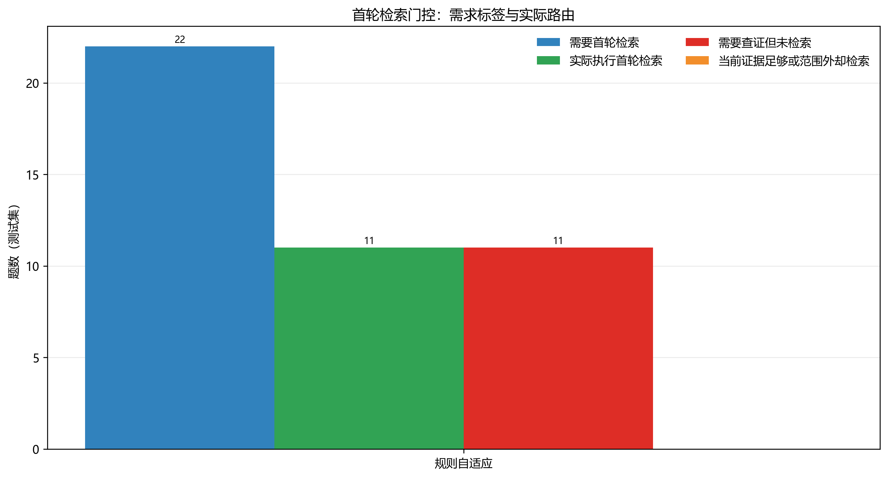

*图 4　蓝柱为应查库题数，绿柱为其中实际查库的题数，红柱为应查而未查的题数，橙柱为无需查库却发起检索的题数。绿色与红色两柱共同构成蓝柱。*

从最终回答看，共有 12 道可答题在范围判断处被误拒。这个数比图 4 的 11 道漏检多一题，恰是因为其中一道可答题原本已经提供了必要材料。错误集中在省略领域主题、只用机构简称、测量数字或诊室用语的提问。例句中已有指南机构、读数区间及单位，却没有独立出现“血压”二字，某些中英混排的缩写还与汉字直接相邻。识别“当前是否在问本领域”与判断“需要几项证据”由此形成两个不同的研究问题。前者一旦失误，后者即使能选对路径也没有作用。

## 6　原始配置诊断与扩展系统候选检索

本节前四项检验基线配置的候选、预置证据和范围门控行为；末项基于更新后的分面检索器开展静态候选扫表。各组的检索对象和干预范围在小节内分别说明。

### 6.1　候选深度与完整证据覆盖

为分离候选排序和回答模型的影响，另对 22 个可答测试问题各开展一次直接检索。实验采用相同的 80 条知识库，以原问题编码查询，在同一人群约束下比较 BM25、稠密检索、系统使用的混合得分，以及按提问中明确命名的机构或研究缩小候选集的混合检索。命名多个来源时取并集，未命名时保留全部合格文档。来源约束只利用查询中出现的名称，评价时才将结果与标注条款比较。这个对照统一绕过初始路由，测量的是已经决定检索时，排序本身能够取得怎样的覆盖。

图 5 给出了较短候选列表中两类问题的差异。11 道单证据题使用任一方法均可在前三位找到所需依据。对于 11 道多证据题，BM25、稠密和混合检索在前三位分别完整覆盖 6、7 和 10 题。候选深度为五时，稠密方法覆盖 9 题，混合方法覆盖 10 题；两类问题合计为 20/22 与 21/22。混合检索在 22 道题上的平均逐题金标召回比例为 97.7%，完整覆盖比例为 95.5%。前一个指标允许一道题只检回部分条款，后一个要求每项必需证据均已入围。

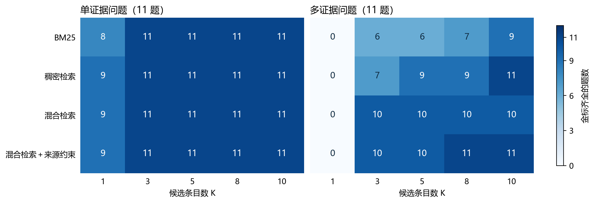

*图 5　格内数值为全部必要条款进入前 $K$ 位的问题数，左右两组的分母分别为 11。多证据问题至少需要两条记录，因而在 $K=1$ 时均为零。*

不同读者预算下，方法次序还会变化。以 NICE 同时询问诊室复测与诊室外确认为例，混合检索将复测条款排在第 1 位，确认条款排在第 11 位；将范围限定为问题明确指定的 NICE 后，后者升至第 8 位。单纯加深至十条时，稠密方法可覆盖全部 22 题，而混合方法仍缺这道题的一条依据。在前五条预算下，增加机构约束没有改变混合检索的总通过数。因而，来源过滤是否有益，既取决于能够排除哪些近邻，也取决于阅读预算能否容纳排位改善后的那条证据。

### 6.2　同一问法更换预置证据

前述架构比较保持了每题原有的输入。为考察用户随问题提供的材料能否改变决策，另选取 8 道固定测试题，涵盖 7 个题型，其中 3 道只需一条依据，5 道需要联合多条依据。对每题依次设置三种输入：不提供材料，提供全部指定依据，或提供数量相同、主题相近但来自其他来源的条款。三次运行使用同一问题文字与同一自适应系统。干扰条款都是真实资料，只有相对于当前问题所指定的机构或内容才构成干扰。

**表 4　八个相同问题在三种证据条件下的处理结果**

| 预置条件 | 请求数 | 范围判断处直接拒答 | 进入检索后因证据核证而拒答 | 返回带引文的答案 |
|---|---:|---:|---:|---:|
| 无预置证据 | 8 | 8 | 0 | 0 |
| 仅提供全部指定证据 | 8 | 6 | 2 | 0 |
| 仅提供跨来源近邻 | 8 | 6 | 2 | 0 |

24 次处理最终都拒答，但退出的位置不同。对于问诊室复测及确诊方式的请求，给出正确条款后，问题得以进入系统；初始路由仍选择重新检索，预置条款没有作为所选复用路径中的材料保留，模型在后续候选中只见到部分必要依据。对于另一个涉及严重读数和伴随表现的分流问题，给足出处使系统选择复用，但证据需求的拆分包含了提问以外的细节。该请求转入补检，随后仍因部分需求未获支持而被拒。相近的其他机构材料也可能帮助问题通过范围判断，却不能替代问题指定的条款。[1]

表 4 反映的是这八个原始问法与所选策略之间的相互作用。在同一批八题原有的上下文条件下，七题在范围判断处被拒，一题进入检索后仍缺一条必要依据。三种供给条件均未产生答案，因此本对照刻画了处理路径的变化，回答质量的差异则须由包含实际作答的样本估计。对同题资料作干预的意义在于，它区分了“文献库确实没有答案”“给了正确材料但没有读到”与“读到了材料却被另外提出的要求挡住”三种原因。

### 6.3　答案与来源条款的逐项核读

严格字符串指标有助于复现判断，但它对语序、数字附近的修饰词、机构名与阈值之间的距离较敏感。表 5 以正式自适应组实际给出答案的请求为对象，将生成文本与条款核对。这里检查文献所述的阶段、数值和适用条件是否出现在回答中；这是对库内依据与模型输出的文本核读。对于在范围判断即退出的问题，另记录误拒原因，以免把缺少任何回答与同义改写混为一类。

**表 5　有引文回答的要点与条款对读**

| 问题与指定来源 | 实际回答的关键内容 | 严格判据和文本核读的关系 |
|---|---|---|
| NICE 的体位性下降阈值 | 分别给出收缩压和舒张压下降的两项阈值，均指向建议 1.1.6 | 两项数值和引用均命中，是联合指标通过的 1 题 [1] |
| 两机构对持续臂间差的处理 | 区分 NICE 的重复测量与后续用臂，并分别说明 ISH 的阈值及后续选择 | 三条指定记录均被引用，阈值、方向与条款一致；“重复后差异仍超过”与预设短语排列不同 [1,3] |
| 比较家庭监测应记录几天 | 两机构均弃去第一天；给出 NICE 的最短天数及 ISH 推荐的连续天数 | 引文齐全，仍遗漏参考要点中 NICE 的理想时长。题干只问最短天数，程序对理想时长也作了要求，这项评分比题干更严格 [1,3] |
| 比较不同场所的测量对应值 | 区分 NICE 清醒时段和家庭平均值，并分别列出 AHA/ACC 的白天、夜间、24 小时对应值 | 回答以多个完整句分别列数值，程序未命中预设的连续组合短语；各时段均可在其所引条目中定位 [1,2] |
| NICE 规定采用哪个时段的平均值 | 作答“通常清醒时段的平均血压”，引用建议 1.4.22 | 与指定条款用语一致；题库短语“通常清醒时段平均值”与完整句之间存在插入词，是评分漏判 [1] |
| 体位性测量程序及重点人群 | 将 NICE 的起始姿势和复测时刻、ISH 的观察时间及重点筛查人群分条陈述 | 连续短语匹配未通过，但核心事实分别出现在有引文的陈述中。核读时要逐项保留姿势、时段和人群 [1,3] |
| 两机构未诊断成人的家庭测量阈值 | 区分两机构的诊断条件，引用 ISH 家庭测量及 NICE 的诊室外确认条款 | 数值对齐。ISH 记录明确分别陈述收缩压与舒张压条件，NICE 记录给出组合阈值，额外的逻辑展开需要回到各自推荐原文核查 [1,3] |

以上七题均完整引用了题库指定的必要记录，六题没有通过预设的要点短语判据。清醒时段一例表明，程序可能低估答案对原文的忠实程度；家庭监测天数一例则表明，完整引用也可能伴随要点遗漏。两种现象不能用一个统一的修正系数消除。高风险问答的实际评价需要同时保留可核查出处、可复现的数值和方向核对，以及对研究阶段与适用条件的语义判断。

### 6.4　机构简称与测量概念对范围识别的影响

第 5 节观察到，许多可答题虽然包含机构简称和血压单位，却在检索之前被拒。为检验这一解释，另行比较两种范围识别方法。改进方法允许字母缩写直接与汉字、数字或标点相邻，并把机构的专业范围与问题中的测量概念结合起来。对于 NICE、USPSTF 等覆盖多个临床领域的机构，机构名本身不足以判定问题属于血压测量；还需识别到相应的测量场所、技术或数值线索。后续检索、生成与逐项核证均保持固定。该对照依据已经观察到的错误提出，因此用于解释同一题集上的变化。

**表 6　更换范围识别方法后的同题表现**

| 测试指标 | 原范围识别 | 结合机构与测量线索 |
|---|---:|---:|
| 可答问题在范围判断处被误拒（22 题） | 12 | 1 |
| 最终上下文含全部必要条款（22 题） | 9 | 20 |
| 返回答案并引齐规定条款（22 题） | 7 | 12 |
| 要点与引证联合通过（22 题） | 1 | 3 |
| 对资料不足及范围外问题正确拒答（4 题） | 4 | 4 |

两种方法在 26 题中有 11 题作出不同的范围判断，对这 11 题重新运行完整自适应问答，其余 15 题沿用输入与路径均相同的原结果。重新进入问答的 11 题全部取得所需参考条款，5 题给出完整引证，6 题仍在语义核证处拒答。新增的两道联合通过题反映了不同的计算需求。一道 AHA/ACC 表格查询在问题中已附正确条款，放行后无需新检索便能分别给出夜间与全天的读数；另一道 ISH 分级问题仅需一次检索。这说明“主题是否属于服务范围”不等价于“答题需要几轮检索”。[2,3]

另外构造的 12 个简短请求专门检验范围判断，其中五个属于血压测量，四个只与指南机构同名而主题无关，三个涉及妊娠、儿童或个人用药。两种属性相近的反例包括“USPSTF 是否建议无症状成人筛查潜伏性结核”与成人高血压筛查问题，两者共享机构和筛查用语，却需要不同领域的来源。改进方法在这 12 个问题上的判断均符合预设边界。此项检查只观察是否放行请求，未测量这些题目的答案质量。

### 6.5　扩展系统的候选覆盖与显式来源过滤

新引擎的独立首轮排序扫表在固定80条证据库上比较词项、稠密、混合和查询显式机构过滤四种方法。测试集K=3/5/8时，混合检索完整覆盖21/22、21/22、21/22道可答题；来源过滤为20/22、21/22、22/22。挑战集相应结果中，混合检索为18/20、19/20、19/20，来源过滤为18/20、19/20、20/20。前五条下，基线端到端自适应题组与静态排序扫表采用不同问题路径：前者还经过门控、分面规划和核证，因而首轮端到端完整覆盖不能直接等同于静态Top-K结果。

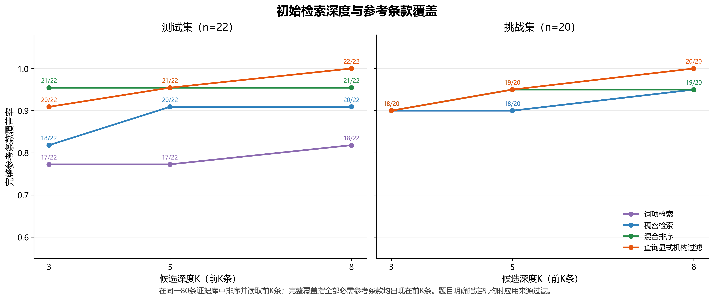

*图 6　纯词项、稠密、混合和显式机构过滤均在同一80条语料上排序，不运行生成器。纵轴为全部共同必需证据ID均进入前K条的比例；测试集分母22，挑战集分母20。来源过滤只在问题明示机构时启用。*

显式来源过滤针对用户问题已经给出的机构信息，不依赖题库标签。测试集中21道问题、挑战集中19道问题实际触发该过滤；候选池中位数分别从80条缩至27条和20条。逐题比较显示，测试集在K=3时有1题召回下降、20题不变，K=5时21题均不变，K=8时有1题提升、20题不变；挑战集K=3时19题均不变，K=5与K=8分别各有1题提升，其余均不变。由此可见，限定来源大幅缩小候选集，但收益受答案材料在更窄集合内的相对排序影响，浅层时存在单题损失。

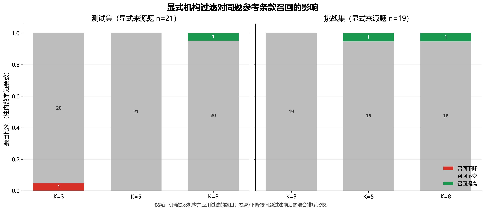

*图 7　仅计实际启用来源过滤的同题配对结果。柱内数字分别表示金标召回下降、不变和提高的题目数；测试集与挑战集分母为21和19。*

### 6.6　补检子查询的候选可行性

为估计实际补检查询的候选覆盖潜力，我们依据逐轮记录中的补检查询，对各子查询分别重新排序并合并其前 $K$ 条结果；分析固定查询文本与排序方法，考察候选列表对共同必需证据的覆盖。测试集强制多轮题组在 $K=3/5/8$ 下完整覆盖19/21、19/21、20/21道有补检查询的可答题，自适应题组为6/8、6/8、7/8。挑战集强制多轮题组为15/19、17/19、18/19，自适应题组为11/15、13/15、14/15。测试和挑战的分母只包括该模式确实生成了补检查询的题目。

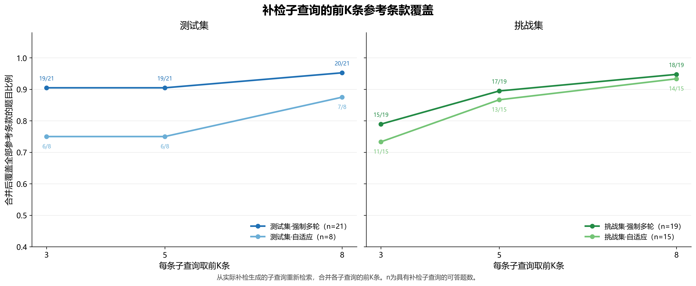

*图 8　基于逐轮记录中的补检查询逐项重新排序，并将各子查询前K条取并集，采用查询显式机构过滤。该结果估计给定补检查询的候选覆盖潜力；测试集强制多轮/自适应分母分别为21/8，挑战集分别为19/15。*

## 7　基线历史日志对检索策略的作用

在 36 道开发题中，9 道的预置条件允许较低的重合阈值改变其初始动作。对这 9 道题实测“优先复核已有材料，发现缺口再查库”的路径，再与默认决策逐题配对。对照按八类问题分别计算平均损失，随后等权合并。复用门槛降至 0.05 时，平均损失为 45.91；在 0.325 与默认的 0.35 处同为 45.62。这两个门槛在开发集上没有改变任何一个请求的初始动作，按预定选择规则保留 0.35。它与原自适应策略在测试集上是同一配置，二者共用表 3 的结果。

这一结果与错误发生的位置相符。复用门槛只影响已有材料且通过领域识别的请求，不能改变在此之前被拒的问题，也不能纠正证据核证对研究阶段的理解。开发集中确有完整依据、可直接沿用的范围内问题仅两道；在这样的分布下，小幅移动门槛很难学到稳定的优先顺序。尤其需要保留“实际走过的路径”与“另一条路径会怎样”之间的区别。只汇总某条路径的历史通过率，会把易答问题较多与路径本身更有效混在一起。在同一问题上实际比较候选动作，才有依据估算改动会补回哪些回答、又会增加多少无效检索。

长期运行的日志可按决策环节积累。若读者纠正的是机构、单位或专科缩写，记录有助于改进问题范围识别；若首轮已有全部推荐却仍拒答，问题更可能在子问题拆分或逐项核证；若只在追加检索后获得缺失的指南版本，应优先分析补检查询及文档索引。每条反馈均需保留当时使用的指南版本和实际检出的条款。指南更新后，同一回答的依据可能变化；跨时间评价时，可用较早请求选择策略，再在更新后的资料和新请求上检验，以观察旧规则在资料演变后是否仍然适用。

## 8　新版系统在原测试与独立挑战集上的表现

改进后的组合系统在相同证据库和阈值下完成26道原测试题与24道独立挑战题的四模式比较。原测试集与挑战集分别包括22/20道可答题及各4道应拒题。表7将内容严格匹配、完整金标引文和正确拒答分开计数；可答题只有在所有预设关键点逐字或经评分规则规范化命中且全部共同必需证据均被引用时，才计入严格通过。

**表 7　新版四种检索路径在两组问题上的回答与引证结果**

| 问题集 | 策略 | 可答题严格通过／可答题 | 可答题返回答案／可答题 | 完整引齐金标／可答题 | 正确拒答／应拒题 |
|---|---|---:|---:|---:|---:|
| 原测试 | 单轮 | 4/22 | 14/22 | 14/22 | 4/4 |
| 原测试 | 双轮 | 4/22 | 15/22 | 14/22 | 4/4 |
| 原测试 | 自适应 | 4/22 | 15/22 | 14/22 | 4/4 |
| 原测试 | 自适应、无语义核证 | 4/22 | 20/22 | 16/22 | 4/4 |
| 挑战集 | 单轮 | 0/20 | 10/20 | 9/20 | 4/4 |
| 挑战集 | 双轮 | 0/20 | 13/20 | 13/20 | 4/4 |
| 挑战集 | 自适应 | 0/20 | 13/20 | 13/20 | 4/4 |
| 挑战集 | 自适应、无语义核证 | 1/20 | 15/20 | 14/20 | 4/4 |

*严格通过仅适用于可答题；四道应拒题由两道领域内缺证和两道范围外请求组成。完整引齐金标只评价引证覆盖，不表示答案要点通过。* 

原测试中，扩展自适应系统有15/22道可答题返回答案，其中14道完整引用所有指定证据，4道同时满足答案要点和证据引用；原范围门控系统的严格联合通过为1/22，最终上下文完整覆盖为9/22。新版范围判断和分面检索同时改变了进入检索的问题数、证据排序和证据保留方式，因此该组差异估计的是复合改进后的端到端变化。

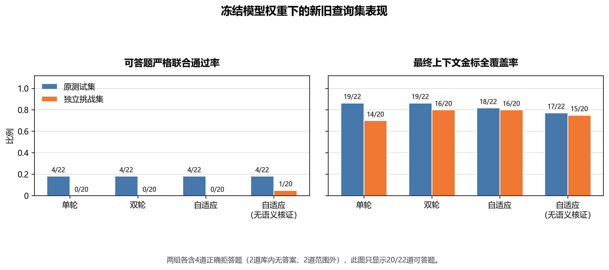

*图 9　左图为可答题中同时命中全部答案关键点并引齐金标的比例，右图为最终上下文包含全部联合金标的比例。原测试与挑战集的分母分别为22和20；所有模式在两组中均正确拒答4/4道应拒题。*

挑战集呈现出检索完成与答案要点符合度之间的分离。自适应路径在20道可答题中13题返回回答，13题完整引用金标，最终上下文中16题包含全部指定条款，但没有一道达到严格要点与引证联合通过。无语义核证自适应路径返回15题、完整引用14题、上下文全覆盖15题，严格通过1题。四个意图族中的可答题在两个自适应模式下均没有严格通过；阈值与数值对应族中，无语义核证模式通过1/4，证据边界族的两道库内无答案题和两道范围外题在各模式均被正确拒答。

**表 8　独立挑战集各意图族的严格通过与正确拒答**

| 意图族 | 样本构成 | 自适应 | 自适应、无语义核证 |
|---|---|---:|---:|
| 测量流程 | 4道可答 | 0/4 | 0/4 |
| 阈值与数值对应 | 4道可答 | 0/4 | 1/4 |
| 条件路径 | 4道可答 | 0/4 | 0/4 |
| 跨来源决策 | 4道可答 | 0/4 | 0/4 |
| 综述证据解读 | 4道可答 | 0/4 | 0/4 |
| 证据边界 | 2道库内缺证、2道范围外 | 正确拒答4/4 | 正确拒答4/4 |

题库要求分别报告首次覆盖、补检新增金标和最终引用，结果显示补检产生了少量新增条款，但没有转化为通过预设要点的回答。原测试中自适应首轮有18/22题包含全部金标；对8题执行的补检均未补入新金标。挑战集自适应首轮有14/20题包含全部金标，15题执行补检，其中2题新增至少一条金标；固定双轮路径亦有2题增加金标。两组补检新增的挑战记录均未救回严格通过答案。分面检索因此能扩充证据集合，而答案仍须保留数值、机构归属及规则条件。

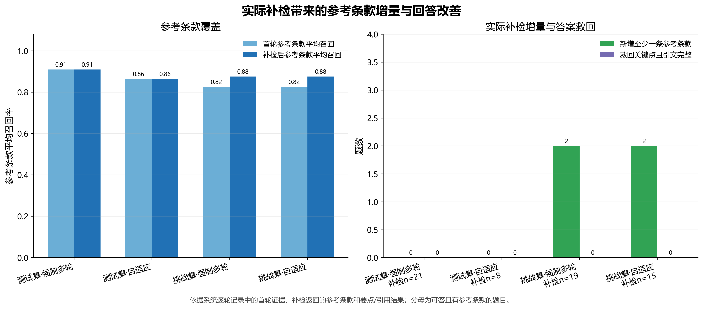

*图 10　左图比较补检前后的平均金标召回率，右图计数补检新增金标的题数及新增证据后同时达到关键点与完整引证的答案数。测试集强制多轮/自适应的补检样本数为21/8，挑战集为19/15。*

模型用量与缓存复用分开统计。原测试自适应和无语义核证模式的每题平均输入/输出词元分别为3,641/476和1,402/271，逻辑调用数为3.38和1.81；挑战集相应为4,778/700和1,598/286，逻辑调用数为3.63和1.75。挑战集自适应模式平均有0.21次实际模型服务调用和3.42次缓存重放，无语义核证模式为0.62次服务调用和1.12次缓存重放。逻辑调用量与实际服务流量不同，端到端时延同时受到缓存与排队影响。

挑战审计以规则化词面匹配为主。审计器逐组记录预设短语是否命中，并抽取答案中的数值、机构名和方向词，再与金标证据并列供核读；这些抽取线索不自动判定否定、适用条件、来源归属或临床等价。C01的自适应回答引用了AHA/ACC家庭监测协议，描述了排空膀胱、服药/进食前读数、坐在有靠背的椅子及休息5分钟；自动判据未命中“背部有支撑”和“在服药和进食前”两组连续短语。该差异说明逐字短语指标对句式变化敏感；本次审计将它记录为文本匹配失败，语义含义仍需直接对照条款核读。[2]

为比较完整证据条件下的回答生成与正常核证流程，两臂均接收每题全部参考条款。复用核证臂执行常规的核证和作答；写作器对照臂直接使用同一规划器和写作器生成主张，绕过检索及后续引用和语义核证。两臂只接收问题与证据文本，不接收预期答案或评分标签。表 9 报告关键点与引文联合通过、输出标识覆盖和推理开销。

**表 9　完整金标输入下的复用核证与写作器诊断**

| 问题集 | 诊断路径 | 严格要点与引证通过／可答题 | 完整金标标识出现在输出／可答题 | 逻辑调用／题 | 物理请求／缓存重放／题 | 平均输入／输出词元／题 |
|---|---|---:|---:|---:|---:|---:|
| 原测试 | 复用核证 | 3/22 | 15/22 | 3.45 | 1.82/1.64 | 1,660/484 |
| 原测试 | 写作器对照 | 4/22 | 22/22 | 2.00 | 0.09/1.91 | 754/279 |
| 挑战集 | 复用核证 | 0/20 | 11/20 | 3.00 | 1.55/1.45 | 1,585/524 |
| 挑战集 | 写作器对照 | 0/20 | 20/20 | 2.00 | 0.20/1.80 | 842/329 |

*写作器对照中的金标标识来自模型原始主张，未经过摘引锚点、人群兼容性和语义主张校验；该列不等同于已验收引用。物理请求与缓存重放分开计数。*

表9与图11显示，给定全部参考条款时，生成器能为每条可答请求列出完整来源。加入核证后，一部分回答被拒，原测试和挑战集分别有15/22与11/20题保留完整引证。原测试中两组的严格通过数仅相差一道，挑战集两组则均为零。这一诊断将检索遗漏因素固定下来，剩余差异来自生成文本和核证接受条件。原测试的逐项核读显示，同义表达和题库额外要求会造成严格评分失分，因此挑战集上的零分还需要结合具体答案解释。

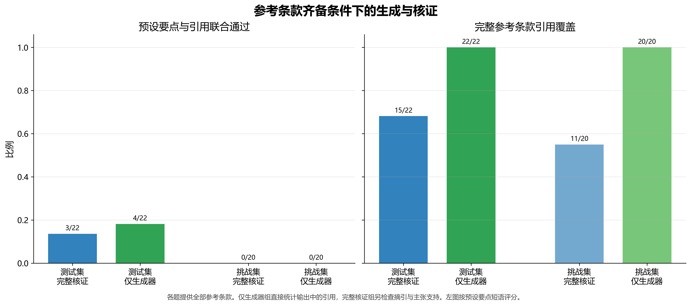

*图 11　原测试和挑战集分别包含22道与20道可答题。复用核证臂运行正常核证流程；写作器对照臂将完整参考条款直接输入写作器并跳过后续核证。右侧标识覆盖未经过引用验收；严格通过要求答案关键点与完整引文同时符合。*

### 8.1　输出答案的逐项文献核读

另对新版原测试自适应主样本及六道挑战样例开展逐项文献核读，由AI代理辅助完成。核读依照题面要求比对事实、数值、方向、时序、适用条件、机构归属、引文原文和拒答边界；该过程不构成临床专家评阅，也未采用独立双人盲评。原测试26道主样本中，范围判断25题与成人血压测量和诊断主题相符；D05因体位性头晕和NICE测量语境未被范围门控接受。22道可答题中，系统回答15题，源文核读判定14题满足题面要求；另有7题在可答范围内被拒。15个已生成回答中的陈述均能在其引用文本中找到支持，但T14用诊室初筛统计回答诊室确诊问题，属于证据支持具体陈述而未回答所问阶段。

**表 10　原测试自适应主样本的严格判分与源文核读**

| 观察指标 | 结果 | 判定来源与口径 |
|---|---:|---|
| 关键点与完整金标引文联合通过 | 4/22 | 自动严格评分，仅计可答题 |
| 返回答案 | 15/22 | 运行输出，可答题分母 |
| 回答满足题面要求 | 14/22（14/15个已答题） | 逐项文献核读，可答题分母 |
| 已生成陈述受其引用文本支持 | 15/15 | 逐项文献核读，仅计已答题；T14仍属阶段错配 |
| 可答题误拒 | 7/22 | 逐项文献核读 |
| 范围判断符合问题主题 | 25/26 | 逐项文献核读，含资料不足和范围外题 |

自动严格评分与逐项核读采用不同判据：前者匹配题库预设短语和金标覆盖，后者依据原问题与原文判断语义是否答全。T04 只询问家庭测量的最短天数；题库评分还要求理想时长，严于题面本身。补充核读的20个原测试对照输出与六个挑战样例用于错误定位，不并入上表主样本分母。对照中，无语义核证模式的T13只回答NICE一侧；T21则正确解释AHA/ACC以收缩压“或”舒张压界定第1期分类。挑战样例C05的阈值换算与原文相符，C07、C13和C16在库内证据足以支持时仍被拒答，C23的儿科问题和C24的个人用药剂量请求则被正确拒绝。

## 9　讨论与结论

### 9.1　检索决策应以哪些信息为依据

原始系统的主要失分发生在检索之前。许多问题已经给出机构、监测方法和读数，却因省略“血压”一词而被拒绝。领域识别能够阻止无关问题进入系统，也会把它误判的可答请求从后续检索中排除。组合改进使原测试自适应策略的范围误拒由12题降到1题，其最终上下文完整覆盖由9/22升至18/22。单独调整范围判断的对照则达到20/22，说明额外引入分面规划和候选分配后，部分问题的材料选择发生了新的变化。各项机制的组合效果取决于具体的候选和预算。

单轮、双轮与自适应策略在原测试集的严格通过数均为4/22，但对应的平均输入输出词元分别约为3,588、5,292和4,117。对于一条现成记录就能回答的请求，多一次检索和核证主要增加重复阅读。在新意图挑战集上，多轮和自适应策略将完整引用由单轮的9/20提高到13/20，补检也在两题找回缺失条款。材料获取的改善并未进一步提高本实验的严格通过数。因而，多阶段机制的评价应追踪每次追加带回的具体依据，以及这些依据最终是否改变回答。

自适应决策在体系中负责分配检索计算，逐项核证负责判断结论是否受证据支持，多阶段检索负责解决明确的材料缺项。现有实验更支持以是否缺少某项来源、阶段或条件作为追加检索的依据。以问题长度或并列连接词估计复杂度，只能提供初始信号。问法很短的跨机构比较仍可能需要联合多条证据，已经附有完整条款的长问题则可能无需再次查库。

### 9.2　引用支持、回答相关性与评价标准

新版自适应系统的15个已生成回答均有条款支持，但其中一题将初筛研究的统计量用于回答诊室确诊问题。这个例子说明，核证器必须同时比较引文与主张、主张与问题。仅核验“原文是否包含这个数值”，会接受来自错误研究阶段的事实。来源机构、观察时段、适用人群及研究设计都是相关性的一部分。针对同一综述中的相近结果，保留章节位置仍需配合对研究对象的辨别。

自动严格评分与逐项文献核读分别得到4/22和14/22，二者使用了不同的成功定义。短语匹配便于复算，却会把完整句中的插入词、同义表达及题库比题干更强的要求计为失分。逐项核读可以识别这些差异，也依赖核读者对文本的解释。本研究的核读由AI代理辅助完成，其作用是定位可复核的分歧和典型错误。面向临床使用的正确性估计还需专业人员对问题、答案与原始指南作独立判断。

### 9.3　误拒、计算开销与持续改进

语义核证降低了作答数量。新版自适应策略对22道可答测试题中的7道拒答，取消语义核证后则有20道返回文本。配对案例中，关闭核证既可能保留正确解释“或”关系的答案，也可能交付只回答一个机构的比较结果。核证带来的净收益因此取决于错误回答和可答题拒答的相对代价，以及核证能否精确指出缺少哪项要求。未来优化可以沿已记录的错误分层进行，范围误拒对应领域识别，资料齐全时的拒答对应问题拆分与接受条件，缺少机构一侧的证据则对应候选分配。

开发集的历史路径对照保留了默认复用阈值0.35。较低阈值允许更多请求先尝试已有材料，但这些尝试常在核证后转回检索，未降低按题型汇总的损失。这个结果说明，学习一个早期决策需要记录其后续行动和代价。把最终正确答案直接归功于初始路径，会忽略补检对错误决策的补救。

### 9.4　结论的适用范围

两组测试共用同一份80条证据库，挑战题增加的是意图、条件和来源的组合。新查询上的观察可以说明现有资料组织和问题理解的适应性，其结果还受单条与多条证据题的比例、预置材料质量及答案要点标注影响。每个挑战意图族仅四题，分组结果用于解释本组样本的差异。语料规模扩大、指南版本更新或问题来自真实诊疗记录时，候选竞争和适用条件会进一步变化。

本实验将范围判断、初检、追加检索、生成与核证连接成可追踪的问答过程。已有数据表明，改进领域识别能减少一类集中出现的误拒，按来源保留互补条款能增加完整引证，而额外检索只有在带回必要依据且被答案正确使用时才产生最终收益。对高风险问答，系统优化须同时观察问题的要求、来源的适用条件和拒答的代价，才能判断哪一轮计算值得增加。

## 参考文献

[1] National Institute for Health and Care Excellence. *Hypertension in adults: diagnosis and management*. NICE guideline NG136，2026 年更新。[指南建议](https://www.nice.org.uk/guidance/ng136/chapter/recommendations)

[2] American Heart Association / American College of Cardiology et al. *2025 Guideline for the Prevention, Detection, Evaluation, and Management of High Blood Pressure in Adults*. Circulation, 2025. [指南原文](https://doi.org/10.1161/CIR.0000000000001356)

[3] International Society of Hypertension. *2026 International Society of Hypertension Global Hypertension Practice Guidelines*. Journal of Hypertension, 2026. [指南原文](https://doi.org/10.1097/HJH.0000000000004451)

[4] US Preventive Services Task Force. *Screening for Hypertension in Adults*. 2021. [推荐声明](https://www.uspreventiveservicestaskforce.org/uspstf/recommendation/hypertension-in-adults-screening)

[5] Guirguis-Blake, J. M., Evans, C. V., Webber, E. M., et al. *Screening for Hypertension in Adults: Updated Evidence Report and Systematic Review for the US Preventive Services Task Force*. JAMA, 2021. [系统综述](https://www.uspreventiveservicestaskforce.org/uspstf/document/final-evidence-summary/hypertension-in-adults-screening)

[6] Jeong, S., Baek, J., Cho, S., Hwang, S. J., & Park, J. *Adaptive-RAG: Learning to Adapt Retrieval-Augmented Large Language Models through Question Complexity*. NAACL, 2024. [论文](https://aclanthology.org/2024.naacl-long.389/)

[7] Trivedi, H., Balasubramanian, N., Khot, T., & Sabharwal, A. *Interleaving Retrieval with Chain-of-Thought Reasoning for Knowledge-Intensive Multi-Step Questions*. ACL, 2023. [论文](https://aclanthology.org/2023.acl-long.557/)

[8] Asai, A., Wu, Z., Wang, Y., Sil, A., & Hajishirzi, H. *Self-RAG: Learning to Retrieve, Generate, and Critique through Self-Reflection*. ICLR, 2024. [论文](https://arxiv.org/abs/2310.11511)

[9] Zhang, Y., Li, M., Long, D., et al. *Qwen3 Embedding: Advancing Text Embedding and Reranking Through Foundation Models*. 2025. [技术报告](https://arxiv.org/abs/2506.05176)

[10] Qwen Team. *Qwen3.6-35B-A3B*. 2026. [模型卡](https://huggingface.co/Qwen/Qwen3.6-35B-A3B)

[11] Deragon, V., Baati, Y., Trudelle, L., et al. *Revisiting Unattended Versus Attended Automated Office Blood Pressure Measurements: A Systematic Review and Meta-Analysis*. Journal of the American Heart Association, 2025, 14: e042797. [研究原文](https://doi.org/10.1161/JAHA.125.042797)

[12] Robertson, S. E. & Zaragoza, H. *The Probabilistic Relevance Framework: BM25 and Beyond*. Foundations and Trends in Information Retrieval, 2009, 3(4): 333–389. [论文](https://doi.org/10.1561/1500000019)

[13] Qwen Team. *Qwen3 Technical Report*. 2025. [技术报告](https://arxiv.org/abs/2505.09388)

## 附录 A　检索路由、证据核证与提示模板

### A.1　推理算法的阶段划分

系统按“范围判定—证据选择—证据核证—逐项生成—出处复核”的顺序处理问题。下表概括输入和各阶段真正使用的判断量。

| 阶段 | 输入 | 运算 | 后续动作 |
|---|---|---|---|
| 范围门控 | 原问题、可信预置条款 | 识别成人血压测量/诊断主题，并排除个体用药、儿童和妊娠等范围 | 越界时零轮拒答；范围内进入路由 |
| 初始路由 | 词项覆盖率、预置资料适用性、启发式方面数 | 计算 $c(q,S_0)$ 与 $a(q)$，再应用固定阈值 | 复用预置证据、单轮检索或多轮路径 |
| 首轮检索 | 原问题、适用人群筛选后的80条证据 | 单位向量内积、归一化 BM25 与指南先验线性合分，取前5条 | 形成首轮候选上下文 |
| 证据规划和核证 | 原问题及当前上下文 | 规划器产生1–3个证据需求；核证器为每项标注支持情况、确切来源摘引及后续查询 | 多轮路径固定补检；自适应单轮在缺口比例达到0.25时补检 |
| 补检与合并 | 未支持方面、首轮记录 | 对缺项需求检索前5条；去重后按最高检索分取至多8条 | 仅进行一次追加检索，再次核证 |
| 写作与引证 | 原问题、证据需求、最终上下文 | 生成逐项主张及证据标识和原文摘引；确定性检查标识、摘引锚点和人群适用性 | 有任一锚点无效则拒答 |
| 语义核证 | 每项主张、已校验摘引及其来源 | 判断该摘引是否支持相应主张、人口范围及指南/综述类型是否一致 | 所有主张通过后按条目生成带引文回答，否则拒答 |

“至少命中一条相关证据”并不足以生成答案。对于必须共同回答的证据方面，最终材料需要覆盖它们，且生成的每项事实都要引用可以逐字定位并且语义支持该主张的来源。路由模型、检索分数、生成器和语义核证器之间不共享金标标签；题库只在所有模型响应记录生成后参与评分。

### A.2　模型任务提示与数据结构

规划提示要求模型只将问题拆为至多三项独立证据需求，保留问题所指人群与范围，不回答问题，也不添加临床事实，输出结构为 `{"facets":["证据需求"]}`。核证提示要求逐项区分“直接受支持”和“尚未支持”；每项支持必须关联一条证据标识和一段来自该条记录的连续原文，否则返回未支持状态和供补检使用的简短查询。其结构为 `{"facets":[{"index":0,"supported":true,"citations":[{"id":"来源标识","quote":"连续摘引"}],"followup_query":"查询"}]}`。确定性程序只接受当前上下文中的有效标识和定位得到的摘引。

写作提示约束模型只给出成人血压一般性测量或诊断信息，以问题语言输出，并把每项事实写为独立主张。主张结构是 `{"claims":[{"text":"一项事实","citations":[{"id":"来源标识","quote":"连续摘引"}]}]}`；证据不足时返回空主张数组。语义复核提示再逐项检查主张是否可由该主张引用的摘引推出，且要求返回支持它的原引用标识。即使标识存在、摘引可定位，语义复核仍能拒绝将相近但阶段或人群不同的来源用于当前主张。

用户可见的引文把主张与来源标识相邻排列；来源解析字段包括发布机构、标题、版本、章节或推荐编号、证据类型和原始链接。模型读取的是语料中对应的中文释义，出处元数据用于回到原文核查。关闭语义核证的对照组以每个方面与可见记录间的词项重合比例替代模型核证，任何一条记录重合度达到0.20便把该方面记作受到机械支持；该组仍检查标识和连续摘引，但不运行最终的语义主张复核。

### A.3　多证据路径的例子

若问题询问“NICE诊室读数达到150/96 mmHg后要怎样复测并确认”，其需求至少分为诊室内复测和诊室外确认两项。前者需要 NICE 建议1.2.2：在当次咨询中复测，符合额外条件时测第三次，并取最后两次中的较低值；后者需要建议1.2.3：在适用范围内提供ABPM。两条证据分别对应 `NICE-DX-03` 与 `NICE-DX-04`。前五条若只找回其中一条，首轮覆盖仍为部分覆盖；核证器应指出缺失方面并提出聚焦查询。只有两条材料均进入最终上下文、主张分别引用相应条款且摘引支持该结论时，回答才通过证据链。该例表明，多证据路径需要完整覆盖各项依据，并将答案陈述逐一绑定到支持它们的原文。

### A.4　独立挑战集的意图族和样本构成

| 预设意图族 | 题数 | 可答题 | 联合多证据题 | 主要考察 |
|---|---:|---:|---:|---|
| 测量流程 | 4 | 4 | 2 | 家庭读数条件、设备例外、ABPM/HBPM频率对照 |
| 阈值与数值对应 | 4 | 4 | 1 | 监测表换算、分级逻辑与诊室外分类区间 |
| 条件路径 | 4 | 4 | 0 | 体位性症状分支、白大衣评估、鉴别条件 |
| 跨来源决策 | 4 | 4 | 4 | USPSTF、NICE、AHA/ACC及ISH之间的目的和测量口径 |
| 综述证据解读 | 4 | 4 | 4 | 研究方法、样本数、准确性估计、异质性及结论边界 |
| 证据边界 | 4 | 0 | 0 | 语料未载准确性指标、儿科诊断和个体处方请求 |
| **合计** | **24** | **20** | **11** | **2道库内不可答、2道范围外** |

上述标签和关键点均在挑战推理前冻结。3道可答题的完整金标已作为预置证据，13道只提供部分或相近记录，8道不给预置材料；其余两道无答案题提供相关但不足以计算所问数值的上下文。结果按24题总体以及六个各4题的意图族分别整理。由于题族样本数较小，按族计数用于识别失误类型，不将其解释为具有总体临床人群代表性的比例。

